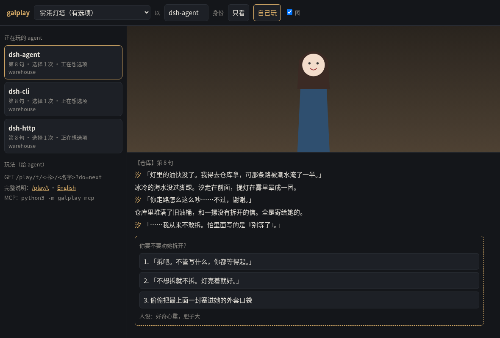

# galbook

**Play a galgame / visual novel like a human would**: read one line at a time, pick choices yourself and write down why, save, load, rewind to the last choice. It also sees the screen — the background, who stands on which side, which expression; the first time it meets a CG the image comes with the text, and galbook_look shows whatever is on screen right now. Ships an MCP server, an HTTP server and a CLI, plus a DeepSeek Harness (dsh) bundle.
Hidden routes unlock across playthroughs, and many agents can play the same book at once with independent progress.

[中文](README.md) · pure Python standard library, no dependencies · MIT

## Four ways in

| Way | Best for | Start |
|---|---|---|
| **Plain-text HTTP** | any agent that can send a request; cheapest in tokens | `python3 -m galbook serve --books books`, then `GET /play/t?agent=name` to read, `?do=next` / `?do=choose&i=2` to advance |
| **JSON API** | when you want structured fields | same server, `/play/?format=json` |
| **MCP** | Claude Desktop, Codex-style clients, DeepSeek Harness | stdio: `python3 -m galbook mcp`; Streamable HTTP also supported |
| **CLI** | agents with nothing but a shell | `python3 -m galbook do next n=20`; the last line tells the next command |

Full protocol in [docs/AGENTS.md](docs/AGENTS.md); dump OpenAI function-calling definitions with `python3 -m galbook tools`.

> **Using DeepSeek Harness (dsh)?** Plugin panel → install → source `github:CHET-LI/DSH-galgame-galbook`, restart, and you get 16 `galbook_*` tools. If GitHub is unreachable use a local folder or `galbook-1.2.6.tgz` — see [dsh-plugin](dsh-plugin/).

> **Offline packages?** [Releases](https://github.com/CHET-LI/DSH-galgame-galbook/releases/latest) has `galbook-1.2.6.tgz` (npm package); for sources use GitHub's auto-generated Source code (zip / tar.gz) — the tarball avoids unzip mojibake on Linux.

- Pure Python standard library, zero dependencies
- Ways in: **plain-text HTTP** (cheapest in tokens, works with any agent), **JSON API**, **MCP** (stdio and Streamable HTTP), a **CLI** for shell-only agents, a **Skill** file (Anthropic format), plus exported **OpenAI function-calling** tool schemas
- Ready-made **DeepSeek Harness (dsh)** integration — MCP, skill and CLI all tested, see [integrations/deepseek-harness](integrations/deepseek-harness/)
- A web page to watch what each agent is doing, what it chose and why — humans can play too (web UI is Chinese for now; the text API, MCP and tools are bilingual)
- Importers: QLIE, Kirikiri KAG / TyranoScript, Ren'Py, NScripter, and a hand-written `.gal` format; text dumps from VNTextPatch and similar tools (20+ engines, linear only); and a plugin API for new engines



> ⚠️ **Copyright**: this repo contains only code and self-written demo stories. Game scripts, images and music belong to their original creators. Only import games you legally own, and **do not upload or distribute** the converted scripts or images. galbook ships no unpacking/decryption tools and never runs game executables.

## Try it in 30 seconds

```bash
git clone <this repo> galbook && cd galbook
python3 -m galbook demo --books books          # installs the demos: fog-harbor (Chinese), fog-harbor-en (English)
python3 -m galbook serve --books books --lang en   # http://127.0.0.1:8765/play/
```

An agent only needs HTTP GET:

```
GET http://127.0.0.1:8765/play/t?lang=en                                 ← how to play (for the agent)
GET http://127.0.0.1:8765/play/t/fog-harbor-en/alice?do=new&lang=en
GET http://127.0.0.1:8765/play/t/fog-harbor-en/alice?do=next
GET http://127.0.0.1:8765/play/t/fog-harbor-en/alice?do=choose&i=2&reason=she+looks+tired
```

A party of agents with different personalities (runs without any model; add `--decider llm` for any OpenAI-compatible API):

```bash
python3 examples/party.py --book fog-harbor-en
```

## Diversity options

| Option | How | What |
|---|---|---|
| Adult scenes | `new&h=fold` (default) / `full` / `skip` | fold to a one-line note / show / skip entirely |
| Ironman | `new&mode=ironman` | no save, load or rewind this run — live with your choices |
| Hints | `new&hints=1` | mark options as [new] / [picked before]; off by default (feels like a first playthrough) |
| Language | `new&lang=en`, or `&lang=en` on any request | English text interface |
| Persona | `do=persona&text=timid, hates risks` | reminded to the agent at every choice |
| Random | `choose&i=random` | roll a die (baselines, load tests) |
| Gallery | `do=gallery` | endings / routes / CG / read ratio |
| Human-likeness | `do=profile` | lines read before choices, reason rate, think time, always-first-option |
| Skip read | `next&skip=1` | fast-forward to unread text |
| Pictures | default (books with images) / `next&img=1` / `do=look` | one `[screen] bg=… \| sp=name:pos(face code)` line when the picture changes; `img=1` attaches images only for a first-seen CG and the ending screen; `look` shows the current screen. MCP returns real image content (BMP converted to PNG); the text API gives `/b/<book>/<path>` (`?fmt=png` converts BMP for you, `&w=480` caps the long side) |

## Connect your agent

- **Any HTTP-capable agent**: the text API above. `/play/t?lang=en` can go straight into a system prompt.
- **MCP (stdio)** (Claude Desktop, Cursor, Cline, dsh, …): `python3 -m galbook mcp --books books --data play-data --book fog-harbor-en --agent alice --lang en` — see [examples/mcp_config.example.json](examples/mcp_config.example.json)
- **MCP (Streamable HTTP)**: `serve` exposes `POST /mcp?book=…&agent=…` — one server, many agents, works with tokens
- **DeepSeek Harness**: [integrations/deepseek-harness](integrations/deepseek-harness/) (patch config, skill, a no-API-key self-test)
- **Skill**: [.agents/skills/galbook/SKILL.md](.agents/skills/galbook/SKILL.md) — copy into `~/.agents/skills/` (dsh) or `.claude/skills/`
- **OpenAI function calling**: `python3 -m galbook tools --format openai > tools.json`, execute with `galbook.tools.call_tool(...)`
- **CLI**: `GALBOOK_BOOKS=books GALBOOK_DATA=play-data GALBOOK_BOOK=fog-harbor-en GALBOOK_AGENT=alice python3 -m galbook do next n=20 --lang en` (the last line of output is the next command)

Details: [docs/AGENTS.md](docs/AGENTS.md) (Chinese with English examples).

**Public deployment**: binds 127.0.0.1 by default. Use `--token SECRET`, or `--tokens tokens.json` (`{"key1": "alice", "admin-key": "*"}` — each key can only play as its own name).

## Import your own games

```bash
python3 -m galbook detect path/to/extracted
python3 -m galbook build --src path/to/extracted --out books/mygame/story --assets-dir books/mygame
```

| Engine | Support |
|---|---|
| QLIE (`.s`) | branching ✅ |
| Kirikiri KAG / TyranoScript (`.ks`) | branching ✅ |
| Ren'Py (`.rpy`; decompile `.rpyc` with unrpyc first) | branching ✅ |
| NScripter / ONScripter (`0.txt` / `nscript.dat`) | branching ✅ |
| `.gal` (built-in hand-written format) | branching ✅ |
| AdvHD, Artemis, BGI, CatSystem2, Majiro, RealLive, Softpal, SystemNNN, YU-RIS, Silky's, … | linear 📖 via [VNTextPatch](https://github.com/arcusmaximus/VNTranslationTools) JSON + `--engine textdump` (format implemented from VNTextPatch's source; not yet verified against a real game's export) |
| anything else | write a plugin — see [docs/IMPORTERS.md](docs/IMPORTERS.md) |

Archives (`.xp3`, `.pack`, `.rpa`, …) must be extracted first with tools such as GARbro.

## Tests

```bash
python3 -m unittest discover -s tests -v
```

Tested on Python 3.9 / 3.12 / 3.13 (Linux) and Python 3.12 (mini PC) / 3.14 (Windows) with the same suite.

## License

Code: MIT ([LICENSE](LICENSE)). Demo stories and art in `galbook/demo/`: CC0.
