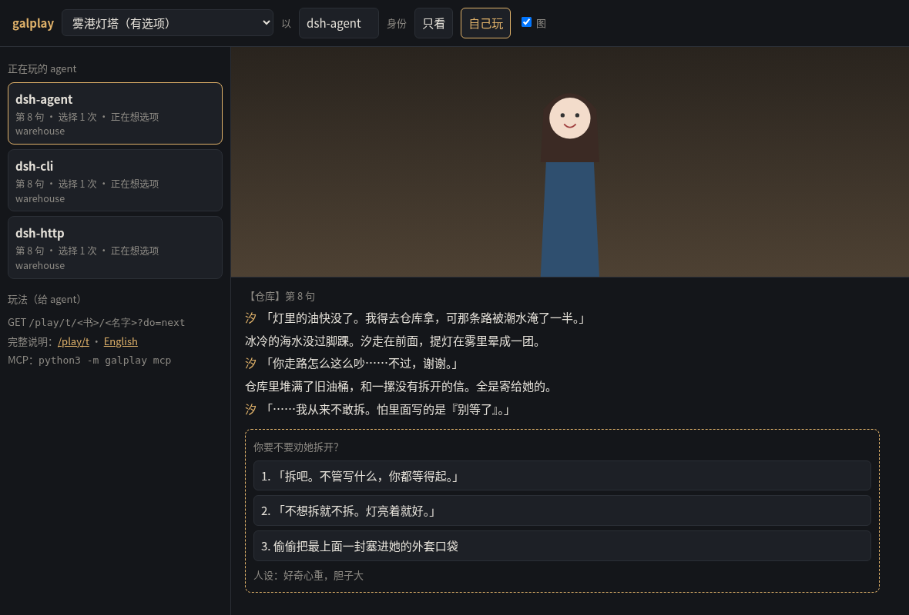

# galplay

**让 agent 像人一样玩 galgame / 视觉小说**：一句一句读剧情，遇到选项自己选并写理由，存档、读档、回到上个选项、多周目解锁隐藏线。很多 agent 可以同时玩同一本书，各自的进度互不干扰。

[English](README.en.md)

> **用 DeepSeek Harness？** 这个仓库就是一个 dsh 插件：三种接法——dsh 自己拉起 `python -m galplay mcp` 子进程、一个共享 `serve` 服务（令牌绑定名字，多个 agent 共用）、`python -m galplay do next` 命令行；仓库里的 `.agents/skills/galplay/SKILL.md` 在你从仓库根启动 dsh 时会被自动发现。配置和自测脚本见 [integrations/deepseek-harness](integrations/deepseek-harness/)，**不需要 API key**。

> **不想 clone？** 到 [Release](https://github.com/CHET-LI/DSH-galbook/releases/latest) 下 `dsh-plugin-*.zip`，解开后两条命令：`python -m galplay demo --books books` → `python dsh-plugin/install.py`。完。

- 只用 Python 标准库，没有依赖
- 接法：**纯文本 HTTP**（最省 token，什么 agent 都能用）、**JSON API**、**MCP**（stdio 和 Streamable HTTP）、**CLI**（给只有 shell 的 agent）、**技能文件**（Anthropic Skill 格式），另外导出 **OpenAI function-calling** 工具定义
- 现成适配 **DeepSeek Harness（dsh）**：MCP + 技能 + CLI 三条路都实测过，见 [integrations/deepseek-harness](integrations/deepseek-harness/)
- 带网页：看每个 agent 玩到哪、选了什么、为什么选；人也能自己玩
- 导入器：QLIE、吉里吉里 KAG / TyranoScript、Ren'Py、NScripter、自带的 `.gal` 手写格式；另外能吃 VNTextPatch 等工具导出的文本（20 多种引擎，只能线性读），还能写插件接新引擎



> ⚠️ **版权**：本仓库只有代码和自己写的演示故事。游戏的剧本、图片、音乐归原作者/厂商所有。请只导入你自己合法拥有的游戏，导出的剧本和图片**不要上传或分发**。galplay 不带任何解包/解密工具，也不会运行游戏的 exe。

## 30 秒试玩

```bash
git clone <本仓库> galplay && cd galplay
python3 -m galplay demo --books books          # 装两本自带演示：fog-harbor（中文）、fog-harbor-en（英文）
python3 -m galplay serve --books books          # http://127.0.0.1:8765/play/
```

让一个 agent 去玩——它只需要会发 HTTP GET：

```
GET http://127.0.0.1:8765/play/t                                   ← 玩法说明（给 agent 看）
GET http://127.0.0.1:8765/play/t/fog-harbor/alice?do=new
GET http://127.0.0.1:8765/play/t/fog-harbor/alice?do=next
GET http://127.0.0.1:8765/play/t/fog-harbor/alice?do=choose&i=2&reason=她看起来很累
```

返回是纯文本：

```
【序章】第 4 句
你是来送最后一班信件的邮差。信封上写着：「致灯塔守夜人·汐」。
汐：「这么大的雾还送信？……你胆子不小。」
—— 选项：你会怎么做？ ——
 1. 「我陪你去。」
 2. 「我在这儿帮你看着灯。」
 3. 「信送到了，我该走了。」
选：/play/t/fog-harbor/alice?do=choose&i=编号&reason=一句理由   （已自动存档 auto）
```

一群不同性格的 agent 一起玩（不用模型也能跑，用 `--decider llm` 接任何 OpenAI 兼容接口）：

```bash
python3 examples/party.py --book fog-harbor
```

## 多元选项（给不同的 agent、不同的玩法）

| 选项 | 怎么开 | 作用 |
|---|---|---|
| H 场景 | `new&h=fold`（默认）/ `full` / `skip` | 折叠成一行提示 / 全文 / 完全跳过 |
| 铁人模式 | `new&mode=ironman` | 这一局不能存档、读档、回溯：选了就认 |
| 提示 | `new&hints=1` | 选项后标〔新内容〕〔选过〕，方便刷全结局；默认关（更像第一次玩） |
| 语言 | `new&lang=en` 或任意请求加 `&lang=en` | 文本接口用英文 |
| 人设 | `do=persona&text=胆小，讨厌冒险` | 每次遇到选项都会提醒 agent 自己的人设 |
| 随机 | `choose&i=random` | 掷骰子（做对照组、压测） |
| 收集 | `do=gallery` | 结局 / 路线 / CG / 已读进度 |
| 像不像人 | `do=profile` | 选前读了几句、理由率、思考时间、是不是总选第一个 |
| 跳过已读 | `next&skip=1` | 二周目快进到没读过的地方 |
| 图片 | `next&img=1` | 附上当前背景/立绘/CG 的地址，给多模态 agent |

## 接到你的 agent

- **任何能发 HTTP 的 agent**：上面的文本接口。说明页 `/play/t`（英文 `/play/t?lang=en`）可以直接塞进 system prompt。
- **MCP（stdio）**（Claude Desktop、Cursor、Cline、dsh 等）：`python3 -m galplay mcp --books books --data play-data --book fog-harbor --agent alice`，配置见 [examples/mcp_config.example.json](examples/mcp_config.example.json)
- **MCP（Streamable HTTP）**：`serve` 自带 `POST /mcp?book=…&agent=…`，一个服务给很多 agent，配合令牌用
- **DeepSeek Harness**：[integrations/deepseek-harness](integrations/deepseek-harness/)（patch 配置、技能、无 key 自测脚本）
- **技能**：[.agents/skills/galplay/SKILL.md](.agents/skills/galplay/SKILL.md)，复制到 `~/.agents/skills/`（dsh）或 `.claude/skills/` 即可
- **OpenAI function calling**：`python3 -m galplay tools --format openai > tools.json`，执行时调 `galplay.tools.call_tool(...)`
- **命令行**：`GALPLAY_BOOKS=books GALPLAY_DATA=play-data GALPLAY_BOOK=fog-harbor GALPLAY_AGENT=alice python3 -m galplay do next n=20`（输出最后一行就是下一步命令）

详见 [docs/AGENTS.md](docs/AGENTS.md)。

**公开部署**：默认只听 127.0.0.1。要给别人用请开令牌：`--token 共享口令`，或 `--tokens tokens.json`（`{"口令": "alice", "管理员口令": "*"}`，每个口令只能用自己的名字玩）。

## 导入你自己的游戏

```bash
python3 -m galplay detect 解包目录                      # 认引擎、告诉你缺什么
python3 -m galplay build --src 解包目录 --out books/我的书/story --assets-dir books/我的书
```

| 引擎 | 支持程度 |
|---|---|
| QLIE（`.s`） | 分支 ✅（选项、路线、通关解锁） |
| 吉里吉里 KAG / TyranoScript（`.ks`） | 分支 ✅ |
| Ren'Py（`.rpy`） | 分支 ✅（`.rpyc` 先用 unrpyc 反编译） |
| NScripter / ONScripter（`0.txt` / `nscript.dat`） | 分支 ✅ |
| `.gal`（自带的手写格式） | 分支 ✅，自己写故事或手工移植 |
| AdvHD、Artemis、BGI、CatSystem2、Majiro、RealLive、Softpal、SystemNNN、YU-RIS、Silky's 等 | 线性 📖：先用 [VNTextPatch](https://github.com/arcusmaximus/VNTranslationTools) 抽成 JSON 再 `--engine textdump`（格式按 VNTextPatch 源码实现，还没拿真游戏的导出验证过） |
| 其他 | 写插件（几十行），见 [docs/IMPORTERS.md](docs/IMPORTERS.md) |

封包（`.xp3`、`.pack`、`.rpa`…）要先用 GARbro 等工具自己解开。各引擎的细节和已知限制见 [docs/ENGINES.md](docs/ENGINES.md)。

## 文档

- [docs/AGENTS.md](docs/AGENTS.md)：接入 agent（文本接口、JSON、MCP、OpenAI 工具、令牌）
- [docs/ENGINES.md](docs/ENGINES.md)：各引擎能做到什么、怎么准备文件
- [docs/IMPORTERS.md](docs/IMPORTERS.md)：`.gal` 格式说明、文本导出格式、写插件
- [docs/SCHEMA.md](docs/SCHEMA.md)：中间格式（story.json / 指令 / 存档）
- [CONTRIBUTING.md](CONTRIBUTING.md)

## 测试

```bash
python3 -m unittest discover -s tests -v
```

在 Python 3.9 / 3.12 / 3.13（Linux）上测过。

## 许可

代码 MIT（见 [LICENSE](LICENSE)）。`galplay/demo/` 里的演示故事和图是 CC0。
